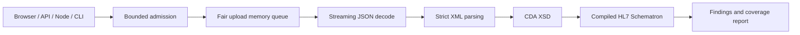

# Architecture, standards, and verification

[← Project home](../README.md) · [Deployment](deployment.md) · [API reference](api.md)

## Request lifecycle



Java 21+ hosts the HTTP adapter and validation engine. Saxon-HE 12.9 executes XSLT compiled from the pinned Schematron using SchXslt 1.10.1. The JDK XML Schema validator checks the pinned CDA schema; Gson serializes JSON reports. No database or application framework is required.

The browser uses HTML, CSS, and JavaScript. The original JavaScript library remains independent of Java; the new Node client communicates with the service over HTTP/JSON. Python scripts prepare assets, check upstream releases, benchmark, verify, and generate the HTML report.

## Shared work and document isolation

At startup, the service verifies the asset inventory and compiles immutable schemas/stylesheets. Trusted bundled vocabulary XML may be cached. Each submitted document owns its parser, schema validator, transformer, line lookup, and finding collector.

There is **no patient-document or result cache**. Warm performance comes from reusing compiled rules and trusted vocabulary. SVRL findings are collected as a bounded stream rather than an unlimited intermediate report.

The pinned releases omit query binding and use XPath 1.0 coercions. Compilation retains backwards-compatible expression semantics, makes phase severity explicit, and assigns deterministic IDs where assertions have none. Original rule tests and messages are retained.

[Queue/memory design and all limits](deployment.md#bounded-queue-and-memory) are described separately from validation semantics.

## Standards and coverage

| Resource | Official release | Used for |
| --- | --- | --- |
| [HL7 CDA Core](https://github.com/HL7/CDA-core-2.0/releases/tag/20260205_SDTC) | `20260205_SDTC` | CDA R2 XSD and approved SDTC extensions |
| [HL7 C-CDA 2.1](https://github.com/HL7/CDA-ccda-2.1/releases/tag/2025SEP) | `2025SEP` | Full supplied Schematron and vocabulary snapshot |
| [HL7 C-CDA 5.0](https://github.com/HL7/CDA-ccda/releases/tag/2026JUL) | `2026JUL` | Full supplied Schematron, bindings, and generation report |

[The source lock](../profiles/sources.lock.json) records immutable archive URLs and SHA-256 hashes. [Asset preparation](../scripts/prepare-assets.py) verifies archives and writes per-file inventories. Startup verifies those files again. No mutable upstream rules are downloaded during validation.

C-CDA 5.0's supplied generation report records **4 errors, 4 unhandled invariants, and 9 non-loaded value sets**. Embedded expansions are limited to value sets with fewer than 1,000 concepts. Consequently, `validationComplete` remains false for that package even when every configured stage executes. C-CDA 2.1 uses its bundled vocabulary snapshot.

A supported document-level template must match the root ClinicalDocument for complete document coverage. Nested section or entry templates firing alone cannot establish a document-level pass. Template versions are derived from the selected pinned profile's rules.

The application does not implement full FHIR StructureDefinition validation or every terminology requirement. HL7's [validation guidance](https://hl7.org/cda/us/ccda/5.0.0/validation.html) describes additional approaches; a StructureDefinition adapter is a future capability, not a current claim.

## Updates and releases

A weekly workflow checks official latest releases against the lock. It signals differences without silently replacing rules or opening automated PRs. An update requires review of checksums, generation gaps, vocabulary changes, tests, and benchmark results.

The container is the primary service distribution. The npm package preserves legacy integrations and supplies the thin modern client/CLI. These release paths can evolve independently. This PR prepares container publishing; npm publishing still needs configuration before the preview is released. Merging does not publish either artifact.

## Verification

Current evidence is recorded in [verification.json](../reports/verification.json), [upload-memory.json](../reports/upload-memory.json), [browser-verification.json](../reports/browser-verification.json), and [benchmark.json](../reports/benchmark.json).

| Check | Coverage |
| --- | --- |
| JavaScript tests | Legacy results/exports, document isolation, ordered batches, frozen options, missing IDs, client behavior, and UI input races |
| Java tests | XML security/complexity, schema findings, rule semantics, coverage, decoded/encoded size limits, upload queue bounds, disconnect recovery, and HTTP contracts |
| Official package integration | Compile and execute both complete pinned HL7 packages |
| Constrained-heap regression | Six simultaneous maximum-size documents, both known-length and chunked framing, in an isolated 1 GiB-heap container; all requests complete without retries |
| Browser verification | Upload/example validation, findings, filters, line navigation, JSON download, mobile layout, stale-result clearing, and queue/heap guidance |
| CI | Node 22/24, Java service, Docker build, upload-memory regression, owner/branch policy, and CodeQL |

```sh
npm ci --ignore-scripts
npm test
npm run service:test
docker compose up --build -d
python3 scripts/verify.py
python3 scripts/check-upload-memory.py
python3 scripts/benchmark.py --requests 100 --concurrency 1 2 4
python3 scripts/build-report.py
```

The benchmark records fixture sizes, concurrency, throughput, p50/p95 latency, and result consistency. It is a limited corpus, not an industry-wide speed comparison or clinical certification. Larger adjudicated corpora, reference-validator comparisons, and sustained production load tests remain important release work.

## Full HTML report

Run the service and open [localhost:17643/architecture.html](http://localhost:17643/architecture.html). The standalone artifact is [reports/architecture.html](../reports/architecture.html); download it to view its rendered design outside the service. GitHub's file viewer shows HTML source rather than hosting it as an application.

## Source map

| Location | Responsibility |
| --- | --- |
| [Java service](../service/src/main/java/org/cdavalidator/) | HTTP, streaming request decoding, validation engine, health probe |
| [Web workspace](../service/web/) | UI, API contract, synthetic sample, engineering report |
| [Source lock](../profiles/sources.lock.json) | Pinned official resources |
| [JavaScript exports](../validator.js) | Legacy API and modern client entry point |
| [Client](../lib/createClient.js) / [CLI](../bin/cda-validate.js) | HTTP integrations |
| [Scripts](../scripts/) | Assets, upstream checks, verification, benchmarks, reports |
| [Dockerfile](../Dockerfile) / [Compose](../compose.yaml) | Build/runtime packaging and local deployment |

## Attribution and licensing

The JavaScript code descends from Eric Wadkins' validator and subsequent work by Priyaranjan (Raj) Tokachichu. John D'Amore's public sample repository is credited in test fixtures; that sample influence is distinct from verified code ancestry.

Application code uses the [MIT license](../LICENSE.md). HL7 assets and runtime dependencies retain separate notices and licenses in [THIRD_PARTY_NOTICES.md](../THIRD_PARTY_NOTICES.md) and [licenses/](../licenses/). This product includes software developed by Health Level Seven.
